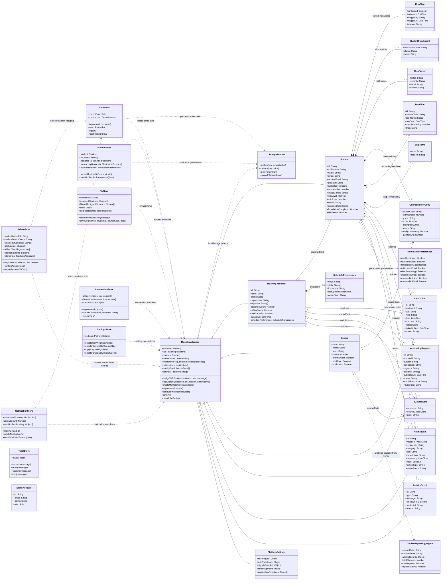

# Frontend Class Diagram

This diagram summarizes the current Vue/Pinia frontend's runtime architecture and the domain objects managed by its mock data layer. The UI uses JavaScript objects rather than a backend ORM.

## Interpretation notes

- `RiskFlag` is the current classification stored on each student. `ActivityEvent` records tier changes over time.
- `CourseHistoryEntry`, checkpoints, risk factors, skip-term history, and deadlines are currently nested in student JSON records.
- `DemoAccount` is an in-memory demo persona; `currentUser` is persisted in browser storage. There is no backend identity service.
- `CourseRepeatAggregate` is loaded from `src/services/mock/data/course_attempts_from_excel.json`; it is aggregate course data, separate from an individual student's course history.
- Pinia stores own UI state and derived views. `MockDataService` is the shared mock-domain service, and `StorageService` serializes selected collections to localStorage.
