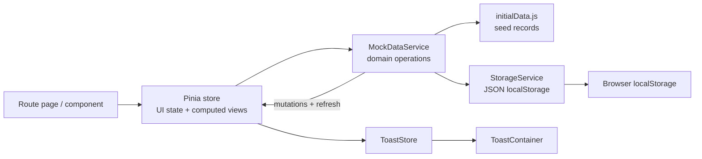

# Component Design

## Application composition

```mermaid
flowchart TB
  App["App.vue<br/>root router outlet"]
  Router["Vue Router<br/>public routes + role guard"]
  Public["Public pages"]
  Home["HomePage"]
  Login["LoginView"]
  Shell["AppLayout<br/>authenticated application shell"]
  Header["AppHeader<br/>role switch, notifications, account menu"]
  Sidebar["AppSidebar<br/>role-specific navigation"]
  PageOutlet["main / router-view"]
  Toast["ToastContainer"]
  Wizard["TaAssignmentWizard<br/>global admin workflow"]

  App --> Router
  Router --> Public
  Public --> Home
  Public --> Login
  Router -->|"authenticated role route"| Shell
  Shell --> Header
  Shell --> Sidebar
  Shell --> PageOutlet
  Shell --> Toast
  Shell --> Wizard

  subgraph Student["Student pages (/student/*)"]
    StudentDashboard["StudentDashboard"]
    CoursePlanner["CoursePlanner"]
    MyProgress["MyProgress"]
    StudentMentorship["MentorshipRequest"]
    StudentNotifications["StudentNotifications"]
    StudentProfile["StudentProfile"]
  end

  subgraph TA["Teaching assistant pages (/ta/*)"]
    TaDashboard["TaDashboard"]
    TaStudentProfile["TaStudentProfile"]
    TaNotifications["TaNotifications"]
    TaProfile["TaProfile"]
  end

  subgraph Admin["Administrator pages (/admin/*)"]
    Executive["AdminExecutiveDashboard"]
    RiskDashboard["AdminDashboard"]
    StudentDirectory["AdminStudentOverview"]
    AdminStudentProfile["AdminStudentProfile"]
    TaDirectory["AdminTaOverview"]
    Interventions["AdminInterventions"]
    RepeatTracker["AdminRepeatTracker"]
    SkipTracker["AdminSkipTermTracker"]
    MentorshipInbox["AdminMentorshipInbox"]
    AdminNotifications["AdminNotifications"]
    AdminSettings["AdminSettings"]
  end

  PageOutlet --> Student
  PageOutlet --> TA
  PageOutlet --> Admin

  subgraph Common["Reusable UI"]
    Modal["Modal"]
    Drawer["Drawer"]
    Avatar["InitialsAvatar"]
    RiskBadge["RiskBadge"]
    StatusBadge["StatusBadge"]
    StatCard["StatCard"]
    Charts["Chart wrappers<br/>Bar, Doughnut, Funnel, Line, StackedBar"]
    InterventionModal["InterventionModal"]
    RiskModal["RiskExplanationModal"]
  end

  StudentDashboard -.-> Avatar
  StudentDashboard -.-> RiskBadge
  StudentDashboard -.-> StatCard
  StudentDashboard -.-> RiskModal
  StudentNotifications -.-> RiskModal
  MyProgress -.-> Charts
  TaDashboard -.-> Avatar
  TaDashboard -.-> RiskBadge
  TaDashboard -.-> StatCard
  TaDashboard -.-> Charts
  TaDashboard -.-> InterventionModal
  TaStudentProfile -.-> Avatar
  TaStudentProfile -.-> RiskBadge
  TaStudentProfile -.-> Charts
  TaStudentProfile -.-> InterventionModal
  AdminStudentProfile -.-> Avatar
  AdminStudentProfile -.-> RiskBadge
  AdminStudentProfile -.-> InterventionModal
  StudentDirectory -.-> Avatar
  StudentDirectory -.-> RiskBadge
  StudentDirectory -.-> InterventionModal
  TaDirectory -.-> Avatar
  TaDirectory -.-> RiskBadge
  TaDirectory -.-> Modal
  Executive -.-> Charts
  RiskDashboard -.-> Charts
  Interventions -.-> InterventionModal
```

## Route and page responsibilities

| Area | Route(s) | Page responsibility |
|---|---|---|
| Public | `/` | Platform overview, demo role launch, and public marketing content. |
| Public | `/login` | Demo account selection and role sign-in. |
| Shared | `/dashboard` | Redirects to the dashboard for the current role; admin goes to the executive dashboard. |
| Student | `/student/dashboard` | Personal standing, milestones, risk explanation, deadlines, TA, and notices. |
| Student | Dashboard external link | Opens the separately deployed course planner at `https://course-planner-140256174016.asia-south1.run.app/login`. The former in-app planner page has been removed. |
| Student | `/student/progress` | Course results, attempts, and academic progress. |
| Student | `/student/mentorship` | Submit and track mentorship requests; show assigned TA availability. |
| Student | `/student/notifications` | Filter, read, and dismiss notifications. |
| Student | `/student/profile` | Student details and notification preferences. |
| TA | `/ta/dashboard` | Assigned roster, workload metrics, risk filters, deadlines, and activity. |
| TA | `/ta/students/:id` | Expertise-scoped student detail, notes, and interventions. |
| TA | `/ta/notifications` | TA notifications and intervention follow-up actions. |
| TA | `/ta/profile` | TA profile and consultation schedule preferences. |
| Admin | `/admin/executive-dashboard` | Program-wide KPIs, risk distribution, course-score trend, and intervention outcomes. |
| Admin | `/admin/dashboard` | Risk-tier counts, recent flagged-student preview, flag activity, milestone health, pipeline, and capacity preview. |
| Admin | `/admin/students`, `/admin/students/:id` | Searchable/paginated student directory and administrative student profile/actions. |
| Admin | `/admin/tas` | Searchable/paginated TA capacity directory and detail/rebalance workflows. |
| Admin | `/admin/interventions` | Intervention outcomes, overdue follow-ups, and reminder actions. |
| Admin | `/admin/repeat-tracker`, `/admin/skip-tracker` | Course-repeat analytics and student skip-term monitoring. |
| Admin | `/admin/mentorship` | Filter, review, respond to, and route mentorship requests. |
| Admin | `/admin/notifications` | Compose/schedule notices and inspect the in-memory sent log. |
| Admin | `/admin/settings` | Risk thresholds, weights, signal toggles, pacing rules, TA capacity, and templates. |

All student, TA, and admin routes render inside `AppLayout`. The router guard redirects unauthenticated users to login and blocks navigation into another role's pages. Home and login are public and render outside that shell.

The legacy `/student/course-planner` path redirects the browser to the external planner, so old bookmarks and saved notification actions do not reopen the removed in-app page.

## State and data flow

| Store | Main consumers / responsibility |
|---|---|
| `authStore` | Login, demo role switching, current user, role checks, reset. Used by router guards, header, and role-specific stores. |
| `adminStore` | Student/TA summaries, filters, selected students, flagging, assignment wizard, CSV export, mentorship filtering. |
| `studentStore` | Logged-in demo student's profile, assigned TA, mentorship requests, course planner state, and notification preferences. |
| `taStore` | Current TA's assigned students, filters, workload, deadlines, activity, bulk notices, and private course notes. |
| `interventionStore` | Intervention filtering, outcomes, overdue follow-up metrics, log/update/remind operations. |
| `notificationStore` | Recipient-scoped notifications, read/dismiss behavior, category filters, admin send flow. |
| `settingsStore` | Risk configuration, monitoring signals, TA capacity, and templates. |
| `toastStore` | Ephemeral global success/error/warning/info messages. |

`MockDataService` is the single frontend data-access boundary used by stores and some workflow components. `StorageService` currently writes JSON to localStorage; it is not a network API. CSV generation is handled by `src/utils/exportCsv.js`, date/status display by `src/utils/formatters.js`, and charts are thin Chart.js/vue-chartjs wrappers.

## Shared component roles

- **Application shell:** `AppHeader`, `AppSidebar`, `ToastContainer`; `AppLayout` additionally mounts the global TA assignment wizard.
- **Visual primitives:** `InitialsAvatar`, `RiskBadge`, `StatusBadge`, `StatCard`.
- **Overlays/workflows:** `Modal`, `Drawer`, `InterventionModal`, `RiskExplanationModal`, and `TaAssignmentWizard`.
- **Charts:** `BarChart`, `DoughnutChart`, `FunnelChart`, `LineChart`, and `StackedBarChart`.
- **Feature pages own composition:** pages combine these components and their role store; reusable components should remain presentational or workflow-focused rather than owning cross-page domain state.

## Scaling boundary

Directory pages currently filter/sort in Pinia and slice the resulting array for 25/50/100-row pagination. The dashboard renders bounded previews. With production-scale records, replace the mock service calls with API queries that accept search, filters, sorting, and page/cursor values; preserve the page/store contract while moving filtering and pagination to the server.
