# Database Schema

## Current persistence

The application currently has no database server. `MockDataService` loads seed records from `src/services/mock/initialData.js` and persists JSON values in browser `localStorage` through `StorageService`. Current storage keys include students, TAs, interventions, mentorship requests, notifications, activity events, settings, TA notes, student notification preferences, and the current demo user.

The schema below is a **normalized relational design proposal** for replacing that mock layer. It is not a migration or a description of a database already deployed. It separates arrays and nested student objects into tables, adds keys and constraints, and retains the workflows the UI currently supports.

```mermaid
erDiagram
  USER_ACCOUNT {
    string user_id PK
    string role "STUDENT | TA | ADMIN"
    string email UK
    string display_name
    string status
    datetime created_at
  }

  STUDENT_PROFILE {
    string student_id PK
    string user_id FK,UK
    string roll_number UK
    string program
    string current_level
    int current_term
    int total_terms
    string intake_cohort
    string status
    string assigned_ta_id FK
    int foundation_completed
    int foundation_total
    int skip_terms
    datetime last_activity_at
  }

  TEACHING_ASSISTANT {
    string ta_id PK
    string user_id FK,UK
    string department
    string title
    string phone
    string bio
    int max_capacity
    datetime last_active_at
  }

  TA_EXPERTISE {
    string ta_id PK,FK
    string expertise_name PK
  }

  TA_AVAILABILITY {
    string availability_id PK
    string ta_id FK,UK
    string frequency "WEEKLY | MONTHLY"
    string active_term
    datetime updated_at
  }

  TA_AVAILABILITY_SLOT {
    string slot_id PK
    string availability_id FK
    string day_of_week
    string time_window
  }

  COURSE {
    string course_code PK
    string name
    string level
    int credits
    int recommended_term
    boolean has_oppe
    boolean bottleneck
  }

  COURSE_PREREQUISITE {
    string course_code PK,FK
    string prerequisite_code PK,FK
  }

  STUDENT_COURSE_ATTEMPT {
    string attempt_id PK
    string student_id FK
    string course_code FK
    int term_number
    int attempt_number
    string grade
    decimal score
    string status
    string assignments_completed
    decimal assignments_average
    string quizzes_completed
    decimal quizzes_average
    string oppe_status
  }

  STUDENT_CHECKPOINT {
    string student_id PK,FK
    string checkpoint_code PK "FOUR_IN_FOUR | SIX_IN_SIX | EIGHT_IN_NINE"
    string status
    string detail
  }

  STUDENT_RISK_FACTOR {
    string risk_factor_id PK
    string student_id FK
    string factor
    string severity
    string detail
    string impact
  }

  STUDENT_RECOMMENDATION {
    string recommendation_id PK
    string student_id FK
    int display_order
    string action_text
  }

  STUDENT_DEADLINE {
    string deadline_id PK
    string student_id FK
    string course_code FK
    string task_name
    datetime due_at
    string task_type
  }

  STUDENT_SKIP_TERM {
    string skip_term_id PK
    string student_id FK
    string term_label
    string reason
  }

  STUDENT_RISK_FLAG {
    string student_id PK,FK
    string tier "SAFE | AT_RISK | CRITICAL"
    string flagged_by_user_id FK
    datetime flagged_at
    string rationale
  }

  INTERVENTION {
    string intervention_id PK
    string student_id FK
    string ta_id FK
    string type
    datetime occurred_at
    string outcome
    string notes
    datetime follow_up_due
    string status
  }

  MENTORSHIP_REQUEST {
    string request_id PK
    string student_id FK
    string subject
    string description
    string urgency
    datetime submitted_at
    string status
    string admin_response
    string routed_ta_id FK
    boolean is_unread_by_admin
  }

  MENTORSHIP_REQUEST_COURSE {
    string request_id PK,FK
    string course_code PK,FK
  }

  NOTIFICATION {
    string notification_id PK
    string recipient_user_id FK
    string category
    string title
    string description
    datetime created_at
    boolean is_read
    string action_type
    string action_route
    string action_label
  }

  STUDENT_NOTIFICATION_PREFERENCE {
    string student_id PK,FK
    boolean risk_in_app
    boolean risk_email
    boolean ta_in_app
    boolean ta_email
    boolean deadlines_in_app
    boolean deadlines_email
    boolean mentorship_in_app
    boolean mentorship_email
  }

  ACTIVITY_EVENT {
    string event_id PK
    string event_type
    string actor_user_id FK
    string student_id FK
    string message
    string reason
    string previous_tier
    string new_tier
    datetime occurred_at
  }

  TA_COURSE_NOTE {
    string ta_id PK,FK
    string student_id PK,FK
    string course_code PK,FK
    string note
    datetime updated_at
  }

  PLATFORM_SETTING {
    string setting_key PK
    string setting_value_json
    datetime updated_at
  }

  NOTIFICATION_TEMPLATE {
    string template_type PK
    string name
    string subject
    string body
  }

  COURSE_REPEAT_AGGREGATE {
    string course_code PK
    string course_name
    string attempt_counts_json
    int total_students
    int total_repeats
    decimal repeat_rate_pct
    string source
  }

  NOTIFICATION_CAMPAIGN {
    string campaign_id PK
    string created_by_user_id FK
    string audience
    string category
    string title
    string message
    datetime scheduled_at
    datetime sent_at
  }

  USER_ACCOUNT ||--o| STUDENT_PROFILE : profile
  USER_ACCOUNT ||--o| TEACHING_ASSISTANT : profile
  USER_ACCOUNT ||--o{ NOTIFICATION : receives
  USER_ACCOUNT ||--o{ ACTIVITY_EVENT : acts
  USER_ACCOUNT ||--o{ NOTIFICATION_CAMPAIGN : creates

  TEACHING_ASSISTANT o|--o{ STUDENT_PROFILE : current_assignment
  TEACHING_ASSISTANT ||--o{ TA_EXPERTISE : specializes_in
  TEACHING_ASSISTANT ||--o| TA_AVAILABILITY : publishes
  TA_AVAILABILITY ||--o{ TA_AVAILABILITY_SLOT : contains

  COURSE ||--o{ COURSE_PREREQUISITE : target_course
  COURSE ||--o{ COURSE_PREREQUISITE : prerequisite_course
  STUDENT_PROFILE ||--o{ STUDENT_COURSE_ATTEMPT : attempts
  COURSE ||--o{ STUDENT_COURSE_ATTEMPT : is_attempted

  STUDENT_PROFILE ||--o{ STUDENT_CHECKPOINT : has
  STUDENT_PROFILE ||--o{ STUDENT_RISK_FACTOR : explains_risk
  STUDENT_PROFILE ||--o{ STUDENT_RECOMMENDATION : receives
  STUDENT_PROFILE ||--o{ STUDENT_DEADLINE : tracks
  COURSE o|--o{ STUDENT_DEADLINE : relates_to
  STUDENT_PROFILE ||--o{ STUDENT_SKIP_TERM : records
  STUDENT_PROFILE ||--o| STUDENT_RISK_FLAG : current_tier
  USER_ACCOUNT o|--o{ STUDENT_RISK_FLAG : classifies
  STUDENT_PROFILE ||--o{ ACTIVITY_EVENT : subject_of

  STUDENT_PROFILE ||--o{ INTERVENTION : receives
  TEACHING_ASSISTANT ||--o{ INTERVENTION : conducts
  STUDENT_PROFILE ||--o{ MENTORSHIP_REQUEST : submits
  TEACHING_ASSISTANT o|--o{ MENTORSHIP_REQUEST : routed_to
  MENTORSHIP_REQUEST ||--o{ MENTORSHIP_REQUEST_COURSE : concerns
  COURSE ||--o{ MENTORSHIP_REQUEST_COURSE : requested_course

  STUDENT_PROFILE ||--o| STUDENT_NOTIFICATION_PREFERENCE : configures
  TEACHING_ASSISTANT ||--o{ TA_COURSE_NOTE : authors
  STUDENT_PROFILE ||--o{ TA_COURSE_NOTE : note_subject
  COURSE ||--o{ TA_COURSE_NOTE : note_course
  COURSE o|--o| COURSE_REPEAT_AGGREGATE : aggregate
```

## Mapping and integrity rules

| Current frontend data | Proposed relational representation |
|---|---|
| `Student.flagStatus` | One current `STUDENT_RISK_FLAG` row per student. The accepted tiers are Safe, At Risk, and Critical. |
| `FLAG_CHANGE` activity records | `ACTIVITY_EVENT` rows containing actor, student, old/new tier, rationale, and timestamp. |
| `Student.checkpoints` | Three rows in `STUDENT_CHECKPOINT`, keyed by student and checkpoint code. |
| `Student.riskFactors`, `recommendedActions`, `upcomingDeadlines` | Separate one-to-many tables, rather than JSON arrays. |
| `Student.courseHistory` | `STUDENT_COURSE_ATTEMPT` rows; enforce uniqueness on `(student_id, course_code, term_number, attempt_number)`. |
| `Student.skipTermsHistory` | `STUDENT_SKIP_TERM`; `skip_terms` can be derived from its row count. |
| `Student.assignedTaId` | Nullable foreign key to `TEACHING_ASSISTANT`; this models the current assignment only. |
| TA `expertise` and `schedulePreferences` | Expertise and availability slot child tables. |
| Mentorship request `courses` array | `MENTORSHIP_REQUEST_COURSE` join table. |
| localStorage notification recipient type/id | `recipient_user_id` FK to a unified account table. |
| Student-private notification preferences | One-to-one `STUDENT_NOTIFICATION_PREFERENCE`. |
| TA notes object keyed by student/course | `TA_COURSE_NOTE` composite primary key `(ta_id, student_id, course_code)`. |
| `INITIAL_SETTINGS` | JSON settings rows plus normalized notification template rows. Version and authorize updates in the backend. |
| `course_attempts_from_excel.json` | Imported `COURSE_REPEAT_AGGREGATE` analytics snapshot, not per-student records. |
| `sentNotificationsLog` in Pinia | It is currently in-memory UI state. `NOTIFICATION_CAMPAIGN` is included as a persistence option if campaign history is required. |

Recommended constraints include `UNIQUE` student roll number and account email, valid risk-tier/status checks, and foreign keys for student, TA, course, and actor references. Credentials and real authentication should be managed by a trusted identity service; the current frontend demo login is not an authentication implementation.
